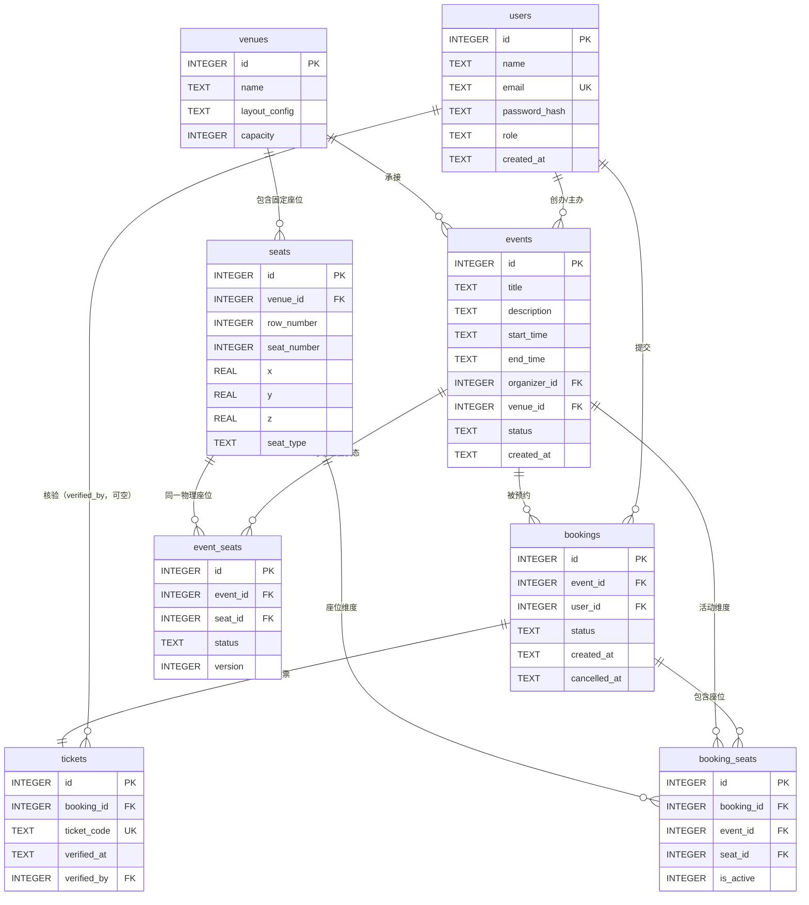

# SeatVerse 数据库 ER 图

> 负责人：E ｜ 依据：`backend/app/repos/migrations/000_schema.sql`
> 说明：第一版只有 1 个场馆，但 `venues`、`seats.venue_id`、`events.venue_id` 字段全部保留，扩展多场馆不需要改表。

## 关系说明

| 关系 | 基数 | 说明 |
|---|---|---|
| `users → events` | 1 : N | 一个主办方可以创建多场活动；普通用户不能创建 |
| `users → bookings` | 1 : N | 一个用户可以有多条预约，但只能看自己的 |
| `users → tickets` | 1 : N（可空） | `tickets.verified_by` 记录核验人，未核验时为 `NULL` |
| `venues → events` | 1 : N | 第一版只有 1 个场馆，但活动仍完整保存 `venue_id` |
| `venues → seats` | 1 : N | 固定座位坐标属于场馆，所有活动共用 |
| `events → event_seats` | 1 : N | 每场活动独立维护每个座位的状态 |
| `seats → event_seats` | 1 : N | 同一物理座位在不同活动里各有一行状态 |
| `events → bookings` | 1 : N | 一场活动可以有多条预约 |
| `bookings → booking_seats` | 1 : N | 一次预约可以选多个座位 |
| `bookings → tickets` | 1 : 1 | `tickets.booking_id` 唯一，一次预约只出一张票 |

## 三条最容易混淆的边界

1. **固定座位 vs 活动座位**
   `seats` 是“座位摆在哪”，`event_seats` 是“这场活动这个座位卖没卖”。同一个 `seat_id` 在 event 2 可以是 `sold`，在 event 3 仍是 `available`。

2. **预约座位 vs 活动座位**
   `booking_seats` 记录“这次预约占了哪些座位”，`is_active=1` 表示仍然有效；取消后置 0，但历史行保留，方便“我的预约”继续显示原座位。

3. **票 vs 预约状态**
   `tickets` 表没有 `status` 列。票面状态由 `bookings.status` 与 `tickets.verified_at` 派生：
   - 预约 `cancelled` → 票 `cancelled`
   - `verified_at` 非空 → 票 `used`
   - 否则 → 票 `reserved`

## 关键约束

- `event_seats(event_id, seat_id)` 唯一：一场活动一个座位只能有一行状态。
- `booking_seats(event_id, seat_id) WHERE is_active = 1` 部分唯一：同一场活动同一座位只能有一条有效占用，但取消后（`is_active=0`）允许重新预约。
- `tickets.booking_id` 唯一：一次预约只出一张票。
- `tickets.ticket_code` 唯一：票号全局唯一。
- `seats(venue_id, row_number, seat_number)` 唯一：同场馆同排同座不能重复。
- 所有外键在连接上通过 `PRAGMA foreign_keys = ON` 开启。
