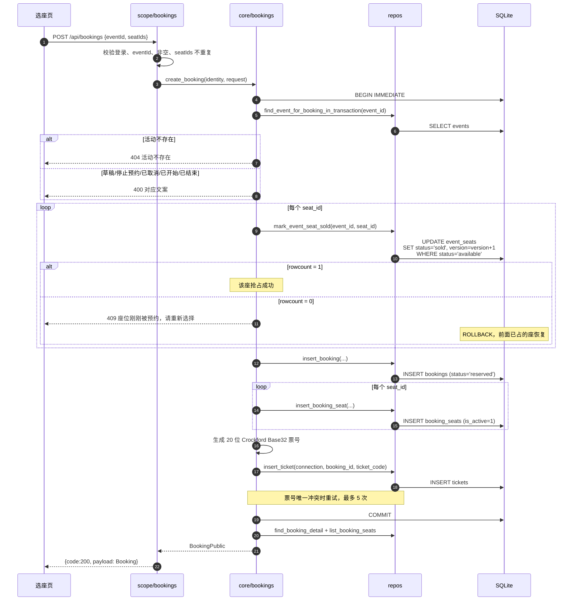
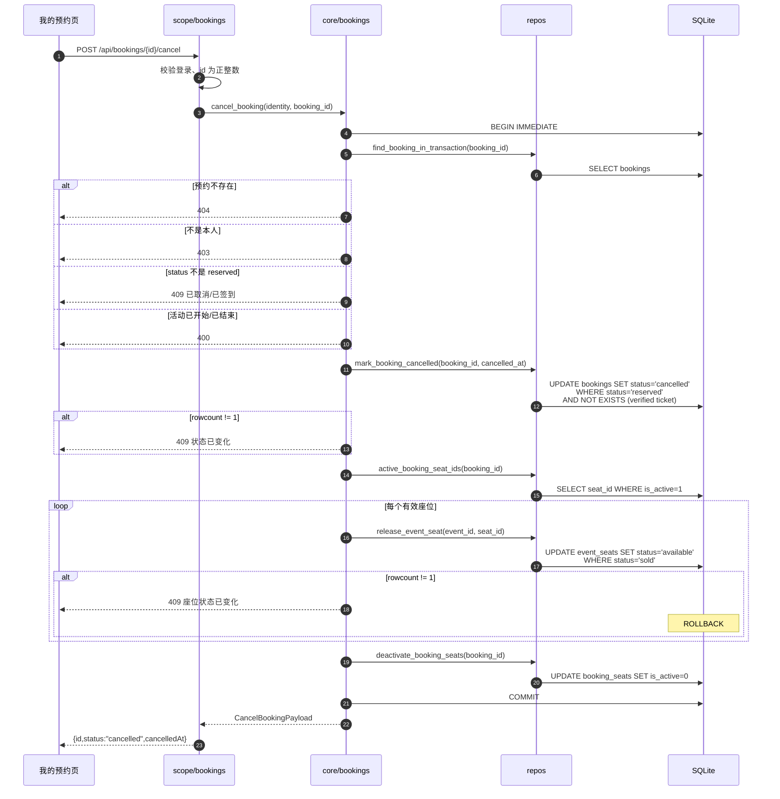
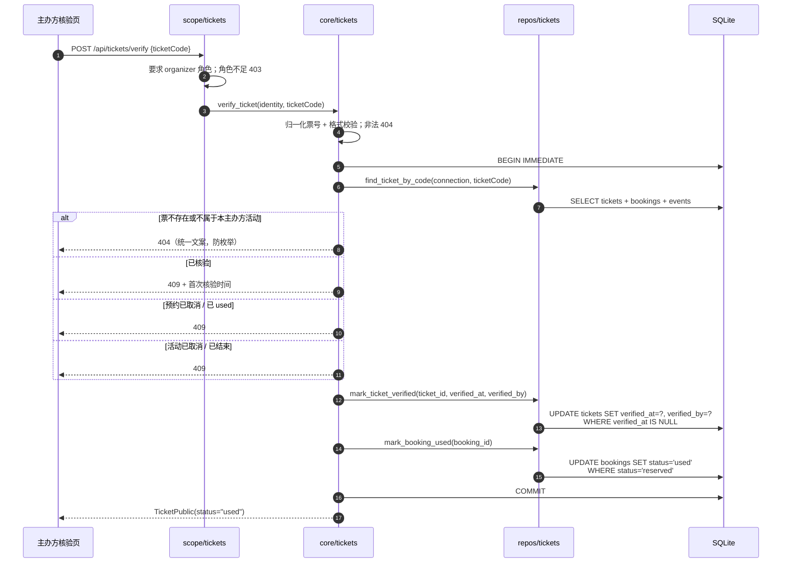

# 预约 / 取消 / 核验事务时序

> 负责人：E（预约与取消）｜ 合作：F（票务核验）｜ 日期：2026-11-21
> 对应代码：`app/core/bookings.py`、`app/core/tickets.py`、`app/repos/bookings.py`、`app/repos/seats.py`、`app/repos/tickets.py`

---

## 1. 预约创建 `POST /api/bookings`

关键点：

- `BEGIN IMMEDIATE` 在第一步就拿写锁，避免两个请求同时读到“空闲”；
- 座位判断写在 `UPDATE ... WHERE status='available'` 里，看 `rowcount`，不先 SELECT 再 UPDATE；
- 预约、座位关联、票在同一事务，任一步失败整体 `ROLLBACK`；
- 多座预约不会出现“A 座成功、B 座失败但 A 已写入”。

---

## 2. 取消 `POST /api/bookings/{id}/cancel`

关键点：

- 活动 `closed` **不影响取消**；只要求本人、`reserved`、活动尚未开始；
- `booking_seats` 置 `is_active=0`，但历史行保留；“我的预约”仍显示原座位；
- 票不单独改状态，票面状态按 `bookings.status` 派生为 `cancelled`；
- 取消与核验都在写事务里重查状态，避免“已取消仍签到”。

---

## 3. 核验 `POST /api/tickets/verify`（F 负责）

关键点：

- 核验与取消使用同一套写事务纪律：`BEGIN IMMEDIATE` + 条件更新；
- 重复核验返回 409，并回显首次核验时间；
- 票号不属于本主办方活动时返回 404，不区分“不存在/他人票”。

---

## 4. 取消 vs 核验的竞争

两个事务都会先拿写锁，因此只会有一方先提交：

| 先提交的操作 | 后提交的操作看到的数据库状态 | 后提交结果 |
|---|---|---|
| 核验成功 | `bookings.status='used'`、`tickets.verified_at` 非空 | 取消返回 409，座位保持 `sold` |
| 取消成功 | `bookings.status='cancelled'`、`event_seats.status='available'` | 核验返回 409，座位保持 `available` |

代码层面的双保险：

- 取消的 `UPDATE bookings` 带 `status='reserved' AND NOT EXISTS (verified ticket)`；
- 核验先查 `verified_at IS NULL`、`booking_status != cancelled`，再条件更新 `tickets` 与 `bookings`。

自动化证据：`backend/tests/test_booking_ticket_race.py`，覆盖：

1. 先核验 → 再取消，409；
2. 先取消 → 再核验，409；
3. 两线程同时取消/核验，恰好一方 200、一方 409，数据库状态与胜者一致。

---

## 5. 错误码速查

| 场景 | code |
|---|---|
| 未登录 / token 失效 | 401 |
| 参数非法、活动不可预约、活动已开始/结束、取消已开始的活动 | 400 |
| 预约/座位/票不存在，票不属于当前用户或本主办方活动 | 404 |
| 不是预约本人、不是 organizer | 403 |
| 座位被抢、重复取消、重复核验、已取消仍核验、活动取消/结束仍核验 | 409 |

所有接口 HTTP 恒为 200，业务结果看响应体顶层 `code`。

---

## 6. 与测试的对应

| 事务点 | 测试 |
|---|---|
| 预约成功/重复提交/多座回滚 | `tests/test_booking_flow.py` |
| 10 用户同座并发 | `tests/test_concurrency.py` + `scripts/concurrency_test.py` |
| 取消后重订、我的预约 | `tests/test_booking_flow.py` |
| 取消/核验竞争 | `tests/test_booking_ticket_race.py` |
| 外键与有效占用唯一 | `tests/test_constraints.py` |
